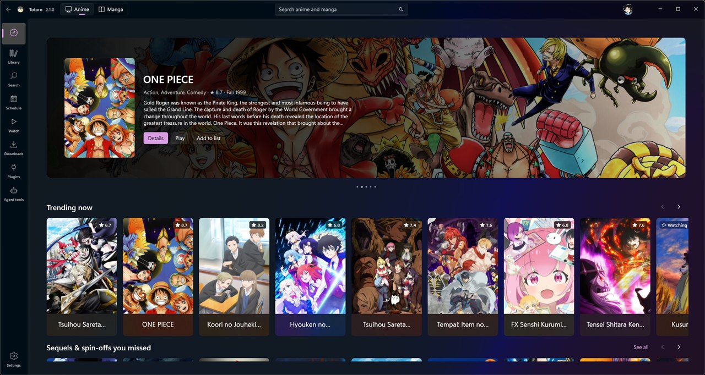
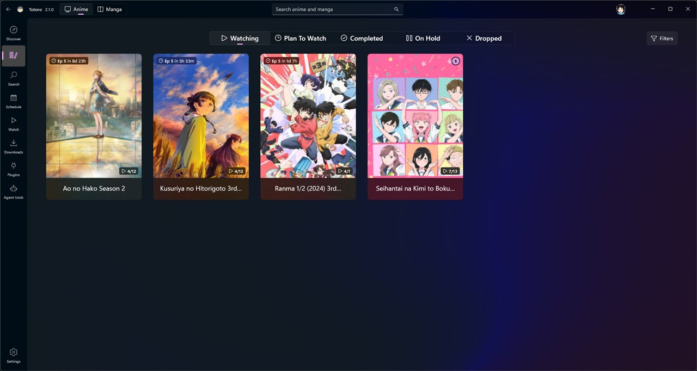
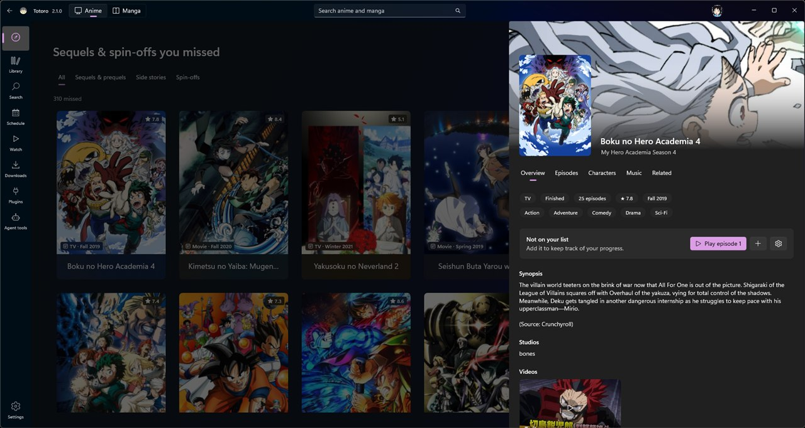
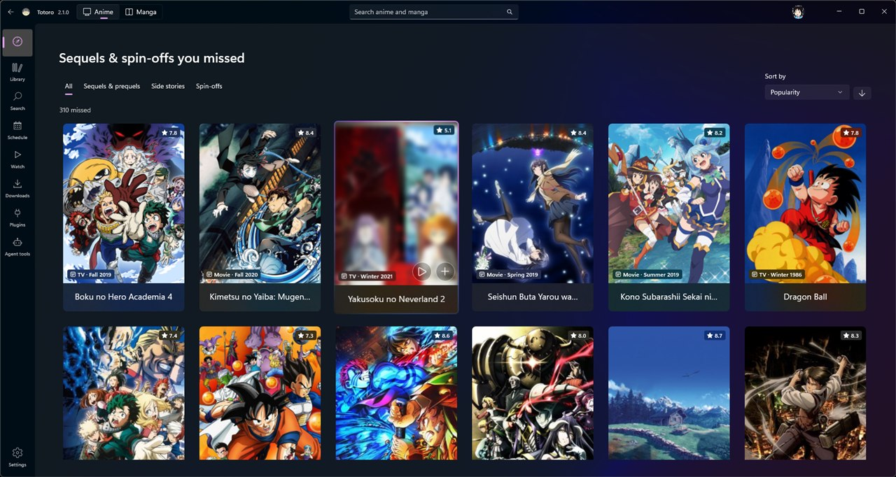
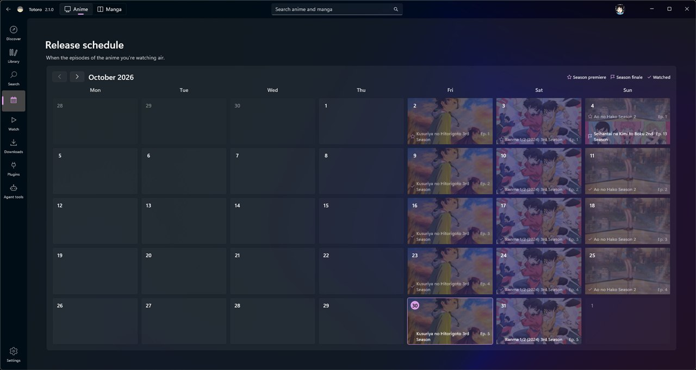
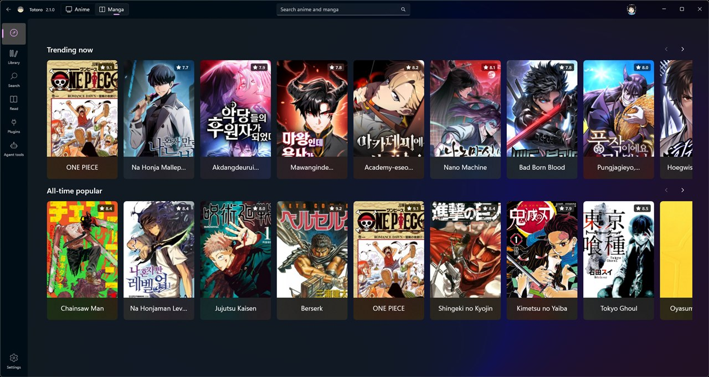

# Totoro

A Windows app for tracking and watching anime, and tracking and reading manga, built with WinUI 3 and .NET 10.



- **Your lists, from AniList or MyAnimeList.** Browse and search anime and manga, and track what you watch and read. When you're signed in to both, changes are made on both; signed out, your AniList list is kept on your PC.
- **Discover.** What's trending, what airs today, what starts next season, and the sequels, prequels, side stories and spin-offs of what you've watched that aren't on your list.
- **Plugins.** Where episodes and chapters come from is up to plugins, which anyone can write; install them from the Plugins page. Plugins can also add anime databases, debrid services and more.
- **Watch episodes.** They play in the built-in player (libvlc) or in mpv, streamed or downloaded, with torrents streamed through rqbit. It can download the next episode while you watch, and tracks episodes you watch in your browser too.
- **Skips openings and endings.** Using Aniskip's times, or found by their sound in downloaded episodes, it offers to skip them or skips them for you. It offers the next episode, and marks episodes watched when you finish them.
- **Read manga.** Chapters open in the in-app reader, which tracks your progress.
- **Schedule.** A calendar of when the episodes of what you're watching air.
- **Episode numbering.** For sources that number episodes across seasons, it uses anime-relations, plus rules of your own.
- **Music.** Each anime's openings and endings, from AnimeThemes, to listen to or watch.
- **An assistant.** Ask it about your list or for anything the app does ("what's airing that I haven't added?", "play the opening of Frieren"); it answers with the app's own cards. It runs on your PC through [Ollama](https://ollama.com), with `qwen2.5:14b` by default (its settings are on the Plugins page).
- **AI-agent friendly.** Everything the app does is also an agent tool (see [AGENTS.md](AGENTS.md)).
- **Stays out of the way.** It can start with Windows, sit in the notification area, and update itself from GitHub releases.

## Screenshots

| | |
|---|---|
|  |  |
| **Library**: your list, with countdowns to the next episodes | **Details**: an anime's episodes, characters, music and related anime |
|  |  |
| **Missed sequels and spin-offs**, filtered and sorted | **Schedule**: when what you're watching airs |
|  | |
| **Manga**: discover, track and read | |

## Building

You need:

- Windows 10 (1809) or later
- The [.NET 10 SDK](https://dotnet.microsoft.com/download)
- The Windows App SDK's runtime, or Visual Studio 2026 with the *WinUI application development* workload

Then:

```bash
dotnet build src/Totoro/Totoro.csproj -c Release -p:Platform=x64
```

Or open `Totoro.slnx` in Visual Studio and run the `Totoro` project. libvlc comes from NuGet. rqbit and mpv aren't part of the build: the app downloads them into its data folder.

### The installer

```bash
./installer/build.ps1 -Version 2.1.0
```

publishes the app self-contained (with .NET and the Windows App SDK's runtime) and builds `installer/output/Totoro-2.1.0-setup-x64.exe` with [Inno Setup 6](https://jrsoftware.org/isinfo.php). It installs for the current user, without admin rights.

GitHub Actions builds the installer for every push and pull request (download it from the run). Pushing a tag such as `v2.1.0` builds that version and attaches it to a GitHub release.

Installed copies update themselves from those releases: Totoro looks for a newer one when it starts (Settings > About), offers it, and installs it on a click, checking the download against GitHub's SHA-256. It closes for the installer, which starts it again.

## Repository layout

```
├── src/
│   ├── Totoro/          The app: pages, view models, modules, playback, agent tools
│   ├── Totoro.Core/     What doesn't depend on WinUI: contracts, settings, services
│   └── Totoro.UI/       Reusable WinUI pieces: controls, dialogs, navigation, theming
├── tests/Totoro.Tests/  Tests
├── installer/           The installer's script (Inno Setup) and build script
├── Totoro.slnx          The solution
├── Directory.Build.props, Directory.Packages.props   Build settings and package versions
└── AGENTS.md            How the code is organised, and its conventions
```

## License

Totoro is MIT licensed; see [LICENSE](LICENSE). What it includes, and their licenses, are in
[THIRD-PARTY-NOTICES.md](THIRD-PARTY-NOTICES.md). libvlc, which it ships, is LGPL-2.1; its license and where its
source is go with it.

## Thanks

- [rqbit](https://github.com/ikatson/rqbit) (Apache-2.0) streams torrents.
- [libvlc](https://www.videolan.org/vlc/libvlc.html) and [LibVLCSharp](https://code.videolan.org/videolan/LibVLCSharp) (LGPL-2.1) play video.
- [NAudio](https://github.com/naudio/NAudio) plays songs' audio.
- Anime data comes from [AniList](https://anilist.co), [MyAnimeList](https://myanimelist.net) and [Jikan](https://jikan.moe).
- Episode details and id mappings come from [ani.zip](https://ani.zip).
- Skip times come from [Aniskip](https://aniskip.com), episode numbering from [anime-relations](https://github.com/erengy/anime-relations), and songs from [AnimeThemes](https://animethemes.moe).
